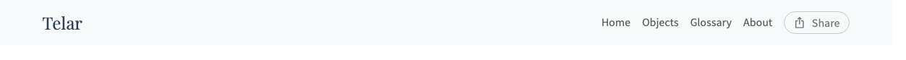

# Navigation Menu Configuration {#navigation-menu-configuration}

Customize your site's navigation menu to include custom pages, external links, and bilingual labels.


In the Compositor, arrange navigation in [Home and Pages](/docs/the-compositor/pages/). This page documents the underlying navigation file.

## What is the Navigation Menu? {#what-is-the-navigation-menu}

The navigation menu appears in your site's header and provides links to:
- Your stories (automatically generated)
- Custom pages (About, Credits, etc.)
- Objects index (automatically included)
- External resources (optional)



## How It Works {#how-it-works}

Navigation is configured through `_data/navigation.yml`. This data-driven approach gives you complete control over menu structure and labels.

When `navigation.yml` exists, Telar uses it to build your menu. If the file is missing, a hardcoded fallback menu appears with basic links (Stories, Objects, About).

## Creating Your Navigation File {#creating-your-navigation-file}

### Step 1: Create the File {#step-1-create-the-file}

Add `navigation.yml` to the `_data/` directory:

```
_data/
├── navigation.yml    # Your custom navigation config
├── objects.json      # Generated objects data
└── project.json      # Generated project data
```

### Step 2: Define Your Menu Structure {#step-2-define-your-menu-structure}

Here's a basic configuration:

```yaml
menu:
  - title_en: "Stories"
    titulo_es: "Historias"
    url: "/"

  - title_en: "Objects"
    titulo_es: "Objetos"
    url: "/objects/"

  - title_en: "About"
    titulo_es: "Acerca de"
    url: "/about/"

  - title_en: "Credits"
    titulo_es: "Créditos"
    url: "/credits/"
```

### Required Fields {#required-fields}

Each menu item needs:

| Field | Purpose | Example |
|-------|---------|---------|
| `title_en` | English label | `"About"` |
| `titulo_es` | Spanish label | `"Acerca de"` |
| `url` | Page URL | `"/about/"` |

### Optional Fields {#optional-fields}

| Field | Purpose | Example |
|-------|---------|---------|
| `external` | Opens in new tab | `true` |

## Menu Item Types {#menu-item-types}

### Internal Pages {#internal-pages}

Link to pages within your site:

```yaml
- title_en: "Methodology"
  titulo_es: "Metodología"
  url: "/methodology/"
```

The URL should match your page's filename (`methodology.md` → `/methodology/`).

### External Links {#external-links}

Link to external resources:

```yaml
- title_en: "Project Archive"
  titulo_es: "Archivo del Proyecto"
  url: "https://archive.example.org"
  external: true
```

When `external: true`, the link opens in a new tab with `target="_blank"`.

### Stories Homepage {#stories-homepage}

Link to the stories list:

```yaml
- title_en: "Stories"
  titulo_es: "Historias"
  url: "/"
```

### Objects Index {#objects-index}

Link to the objects catalog:

```yaml
- title_en: "Objects"
  titulo_es: "Objetos"
  url: "/objects/"
```

## Complete Example {#complete-example}

Here's a full navigation configuration for a research project:

```yaml
menu:
  # Stories homepage
  - title_en: "Stories"
    titulo_es: "Historias"
    url: "/"

  # Objects catalog
  - title_en: "Objects"
    titulo_es: "Objetos"
    url: "/objects/"

  # Custom pages
  - title_en: "About"
    titulo_es: "Acerca de"
    url: "/about/"

  - title_en: "Methodology"
    titulo_es: "Metodología"
    url: "/methodology/"

  - title_en: "Team"
    titulo_es: "Equipo"
    url: "/team/"

  - title_en: "Credits"
    titulo_es: "Créditos"
    url: "/credits/"

  # External link
  - title_en: "Full Archive"
    titulo_es: "Archivo Completo"
    url: "https://archive.example.org"
    external: true
```

## Bilingual Labels {#bilingual-labels}

### How Language Selection Works {#how-language-selection-works}

Telar displays menu labels based on your site's language setting (`telar_language` in `_config.yml`):

- If `telar_language: en` → Shows `title_en` labels
- If `telar_language: es` → Shows `titulo_es` labels

### Fallback Behavior {#fallback-behavior}

If a menu item is missing the appropriate language label, Telar falls back gracefully:

1. Try current language label (`title_en` or `titulo_es`)
2. If missing, try the other language
3. If both missing, show URL as label

## Menu Order {#menu-order}

Menu items appear in the order you list them in `navigation.yml`:

```yaml
menu:
  - title_en: "Stories"      # Appears first
    ...
  - title_en: "Objects"      # Appears second
    ...
  - title_en: "About"        # Appears third
    ...
```

## Updating the Menu {#updating-the-menu}

### Adding a New Page {#adding-a-new-page}

When you create a new custom page:

1. Create the markdown file (`telar-content/texts/pages/contact.md`)
2. Add it to `navigation.yml`:

```yaml
- title_en: "Contact"
  titulo_es: "Contacto"
  url: "/contact/"
```

3. Rebuild your site

The menu updates automatically.

### Removing a Page {#removing-a-page}

To remove a page from the menu:

1. Delete or comment out the entry in `navigation.yml`:

```yaml
# - title_en: "Old Page"
#   titulo_es: "Página Antigua"
#   url: "/old-page/"
```

2. Rebuild your site

The page file can remain in `telar-content/texts/pages/` but won't appear in navigation.

### Reordering Items {#reordering-items}

Change the order in `navigation.yml`:

```yaml
menu:
  # Move "About" to the top
  - title_en: "About"
    titulo_es: "Acerca de"
    url: "/about/"

  - title_en: "Stories"
    titulo_es: "Historias"
    url: "/"

  # Rest of menu...
```

## Fallback Menu {#fallback-menu}

If `_data/navigation.yml` doesn't exist, Telar shows a hardcoded fallback menu:

- **Stories** (homepage)
- **Objects** (catalog)
- **About** (if `about.md` exists)

This ensures your site always has basic navigation, even without configuration.

## Troubleshooting {#troubleshooting}

### Menu Not Updating {#menu-not-updating}

If your menu changes don't appear:

1. **Check YAML syntax**: Use a YAML validator to verify `navigation.yml` is valid
2. **Rebuild the site**: Run `bundle exec jekyll build` to regenerate
3. **Clear browser cache**: Use Ctrl+Shift+R (Cmd+Shift+R on Mac) to hard refresh
4. **Verify file location**: File must be at `_data/navigation.yml` (not `data/` or `_data/nav.yml`)

### Wrong Language Showing {#wrong-language-showing}

If menu labels appear in the wrong language:

1. Check `telar_language` in `_config.yml`
2. Verify you're using correct field names (`title_en` and `titulo_es`, not `title` or `label`)
3. Ensure both language labels are present

### External Link Not Opening in New Tab {#external-link-not-opening-in-new-tab}

Add the `external: true` field:

```yaml
- title_en: "External Resource"
  titulo_es: "Recurso Externo"
  url: "https://example.com"
  external: true    # Required for new tab
```

## Best Practices {#best-practices}

### Clear, Descriptive Labels {#clear-descriptive-labels}

Use labels that clearly describe the destination:

**✓ Good:**
```yaml
- title_en: "Research Methodology"
  titulo_es: "Metodología de Investigación"
```

**✗ Avoid:**
```yaml
- title_en: "Info"
  titulo_es: "Info"
```

### Consistent Ordering {#consistent-ordering}

Keep related items together:

```yaml
# Project pages
- title_en: "About"
- title_en: "Team"
- title_en: "Methodology"

# Content pages
- title_en: "Stories"
- title_en: "Objects"

# External resources
- title_en: "Archive"
```

### Limit Menu Length {#limit-menu-length}

Keep menus focused (5-7 items is ideal). For larger sites, consider grouping content differently or using footer links for secondary pages.

## Related Documentation {#related-documentation}

- [Custom Pages](/docs/site-features/custom-pages/) - Creating pages to link in navigation
- [Configuration Reference](/docs/configure/configuration/) - Complete `_config.yml` options including `telar_language`
- [Customization Overview](/docs/customization/) - Other customization options

---

**New in v0.6.0**: Customizable navigation with bilingual labels and external link support.
