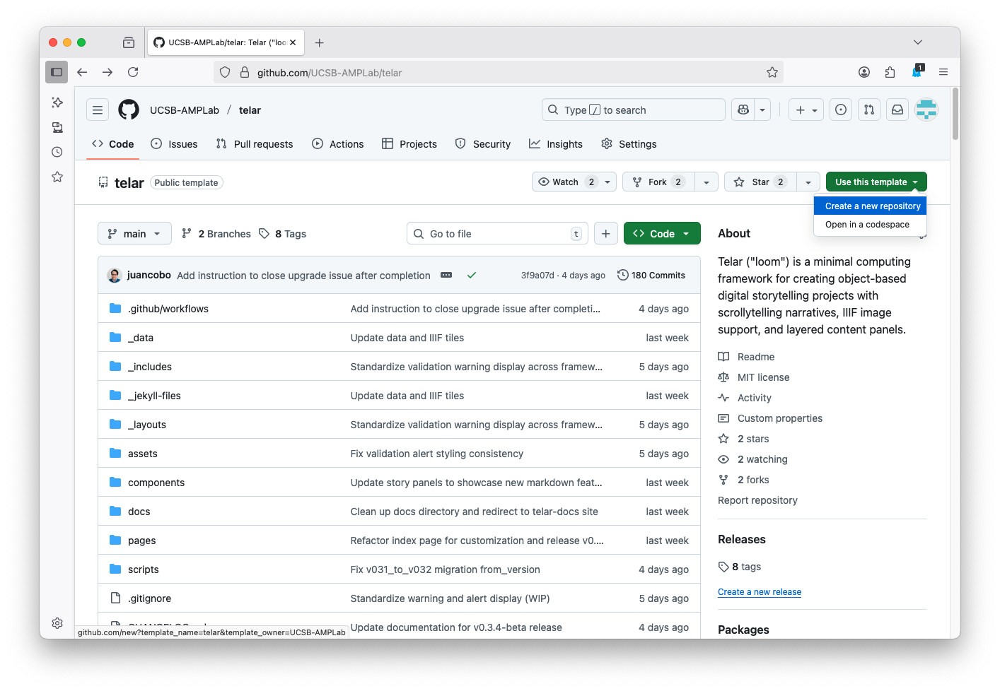
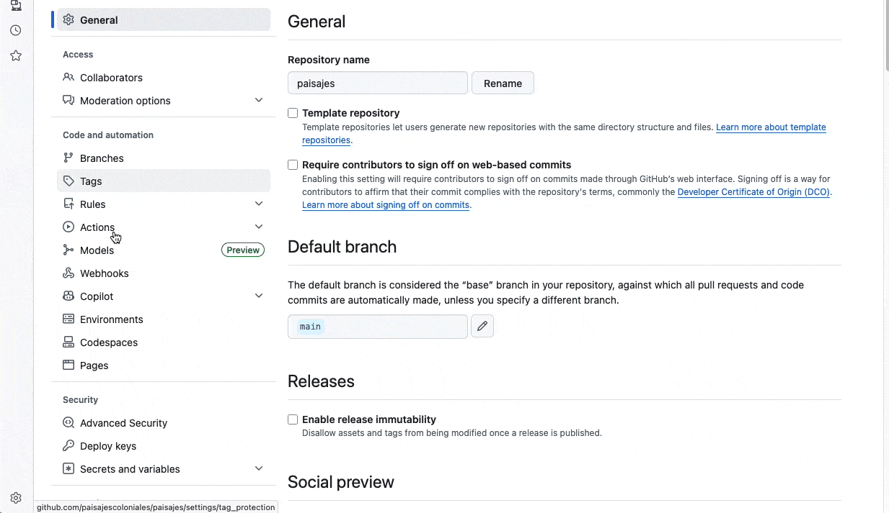

# Use the Compositor {#use-the-compositor}

The Telar Compositor is a visual tool for building exhibitions. You can add objects, write stories, arrange steps, and preview your site — all in your browser, with no coding required.

When you're ready, the Compositor publishes a complete Telar site to GitHub Pages.

## What you'll need {#what-youll-need}

- A [GitHub account](https://github.com/join) (free)
- Images, videos, or audio files for your exhibition

## Get started {#get-started}

Go to [compositor.telar.org](https://compositor.telar.org) and sign in with your GitHub account. The Compositor will ask you to install the Telar Compositor GitHub App — this gives it permission to create and manage repositories on your behalf.

Once signed in, you have two options:

### Create a new site {#create-a-new-site}

Open the project menu and choose **Add or create a repo**, then **A Telar site**. Enter a repository name, a visible title, a language and a theme. Use a short repository name with lowercase letters and hyphens, such as `my-exhibition`.

Choose **Create site** when those details are ready. The Compositor creates the repository from the Telar template and prepares the site for editing.


**Your repository will be public.** GitHub Pages requires a public repository unless you have a paid GitHub plan.




### Connect an existing repository {#connect-an-existing-repository}

If you already created a repository from the [Telar template](https://github.com/UCSB-AMPLab/telar) or have an existing Telar site, select it from the list and the Compositor will import your content.

<strong>Manual setup: create a repository on GitHub first</strong>

If you prefer to create your repository yourself before connecting it:

1. Visit the [Telar template](https://github.com/UCSB-AMPLab/telar)
2. Click the green **Use this template** button
3. Choose **Create a new repository**
4. Give your repository a name — **use lowercase letters and hyphens** (e.g., `my-exhibition`)
5. Make sure **Public** is selected
6. Click **Create repository**

Then enable GitHub Pages:

1. In your repository, go to **Settings** → **Pages**
2. Under **Source**, select **GitHub Actions**
3. Click **Save**

Once that's done, return to [compositor.telar.org](https://compositor.telar.org) and connect the repository.

## What the Compositor can do {#what-the-compositor-can-do}

- **Edit stories visually** — add steps, write text, set image coordinates, and preview your narrative in real time
- **Upload images** — drag and drop images directly; IIIF tiles are generated automatically
- **Add video and audio** — embed YouTube, Vimeo, or Google Drive videos and self-hosted audio files with clip controls
- **Publish in one click** — review your changes, commit to GitHub, and track the build without leaving the editor

For the full guide, see [The Compositor](/docs/the-compositor/).



## Next steps {#next-steps}

Continue with the visual authoring workflow:

- [Objects](/docs/the-compositor/objects/) — Add sources and review their metadata.
- [Use an IIIF object in a story](/docs/the-compositor/iiif-to-story/) — Follow the illustrated khipu example.
- [Story Editor](/docs/the-compositor/story-editor/) — Write steps, capture views and develop panels.
- [Publishing](/docs/the-compositor/publishing/) — Review changes and check the built site.
