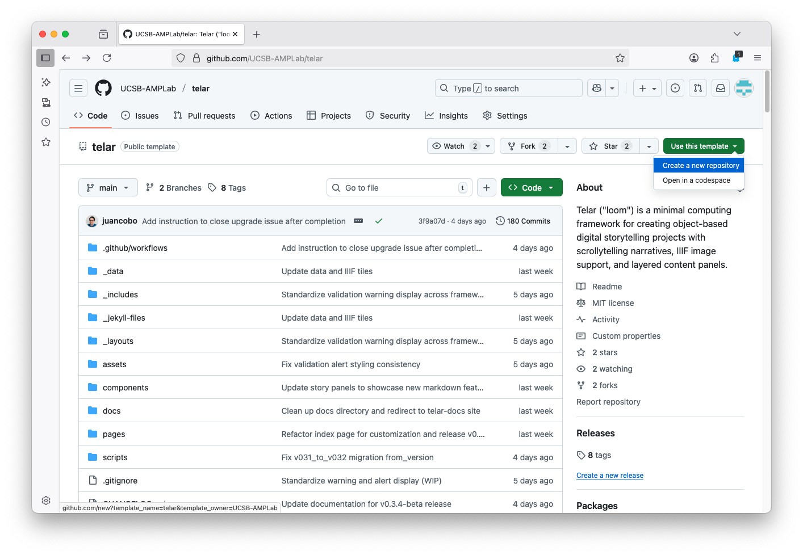
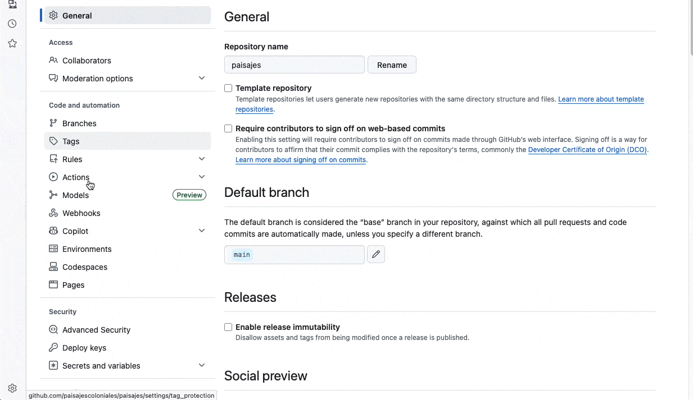

# Usa el Compositor

El Compositor de Telar es una herramienta visual para construir exhibiciones. Puedes agregar objetos, escribir historias, organizar pasos y previsualizar tu sitio — todo en el navegador, sin necesidad de programar.

Cuando estés listo, el Compositor publica un sitio Telar completo en GitHub Pages.

## Lo que necesitas

- Una [cuenta de GitHub](https://github.com/join) (gratis)
- Imágenes, videos o archivos de audio para la exhibición

## Empieza aquí

Ve a [compositor.telar.org](https://compositor.telar.org) e inicia sesión con tu cuenta de GitHub. El Compositor te pedirá instalar la aplicación Telar Compositor en GitHub — esto le da permiso para crear y administrar repositorios en tu nombre.

Una vez que hayas iniciado sesión, tienes dos opciones:

### Crea un sitio nuevo

Abre el menú de proyectos y elige **Agregar o crear un repositorio**; después, **Un sitio de Telar**. Escribe un nombre de repositorio y un título visible, y elige el idioma y el tema. Usa un nombre breve, en minúsculas y con guiones, como `mi-exhibicion`.

Pulsa **Crear sitio** cuando estén listos esos datos. El Compositor crea el repositorio con la plantilla de Telar y prepara el sitio para editarlo.

{: .warning }
> **El repositorio será público.** GitHub Pages requiere un repositorio público a menos que tengas un plan pago de GitHub.



### Conecta un repositorio existente

Si ya creaste un repositorio a partir de la [plantilla de Telar](https://github.com/UCSB-AMPLab/telar) o tienes un sitio Telar existente, selecciónalo de la lista y el Compositor importará tu contenido.

<strong>Configuración manual: crea un repositorio en GitHub primero</strong>

Si prefieres crear el repositorio tú mismo antes de conectarlo:

1. Visita la [plantilla de Telar](https://github.com/UCSB-AMPLab/telar)
2. Haz clic en el botón verde **Use this template**
3. Elige **Create a new repository**
4. Dale un nombre a tu repositorio — **usa letras minúsculas y guiones** (ej., `mi-exhibicion`)
5. Asegúrate de que **Public** esté seleccionado
6. Haz clic en **Create repository**

Luego habilita GitHub Pages:

1. En tu repositorio, ve a **Settings** → **Pages**
2. En **Source**, selecciona **GitHub Actions**
3. Haz clic en **Save**

Una vez hecho, vuelve a [compositor.telar.org](https://compositor.telar.org) y conecta el repositorio.

## Qué puedes hacer con el Compositor

- **Editar historias visualmente** — agregar pasos, escribir texto, ajustar coordenadas de imagen y previsualizar la narrativa en tiempo real
- **Subir imágenes** — arrastra y suelta imágenes directamente; las teselas IIIF se generan de forma automática
- **Agregar video y audio** — inserta videos de YouTube, Vimeo o Google Drive, y archivos de audio autoalojados con controles de clip
- **Publicar con un clic** — revisa los cambios, haz *commit* a GitHub y sigue el estado del *build* sin salir del editor

Para la guía completa, véase [El Compositor](/guia/el-compositor/).



## Siguientes pasos

Sigue con el recorrido de autoría visual:

- [Objetos](/guia/el-compositor/objetos/) — Agrega fuentes y revisa sus metadatos.
- [Usar un objeto IIIF en una historia](/guia/el-compositor/iiif-a-historia/) — Sigue el ejemplo ilustrado del khipu.
- [Editor de historias](/guia/el-compositor/editor-historias/) — Escribe pasos, captura vistas y desarrolla paneles.
- [Publicación](/guia/el-compositor/publicacion/) — Revisa los cambios y comprueba el sitio generado.
